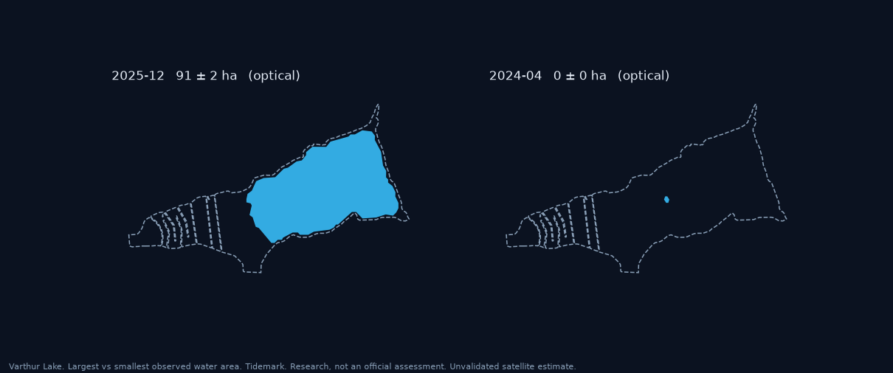
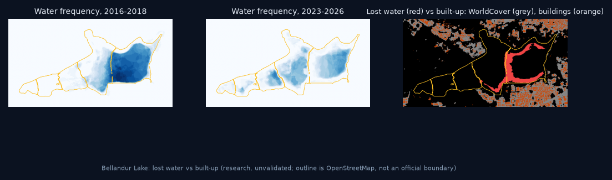

# Tidemark

Open-source tracking of the extent, health and encroachment of Bengaluru's lakes from free
satellite data (Sentinel-1/-2, 2016 to present).

> **Research project, not an official assessment.** Every number on the site is produced by the
> pipeline in this repo and carries its source and uncertainty. Bloom and foam outputs are
> *candidates* only, never confirmed detections. Nothing here is a legal boundary determination.

**Status: Phase 9 of 9 built (website, citizen photo upload, report card and monthly automation, see [docs/automation.md](docs/automation.md); the workflow has not yet run on GitHub, though its updater was trialled locally with a cold cache; uploads need a Supabase project, see [docs/moderation.md](docs/moderation.md); see [VALIDATION.md](VALIDATION.md) for what is and is not validated).** Water extent is broadly supported; the foam, floating-mat and chlorophyll candidates are not validated.

## What it will do

1. Map of Bengaluru lakes with a 2016 to now time slider and before/after comparison.
2. Per-lake pages: health score, trend charts, rainfall overlay, anomaly events, report-card image.
3. "Ghost Lakes" layer: historic water bodies now built over (only where open geometry exists).
4. Citizen photo submissions matched to the nearest cloud-free satellite date (moderated, never auto-published).

## Preview

Varthur Lake, largest vs smallest observed open-water extent (research estimate, unvalidated):



More images and 2016-2026 time-lapse videos for each lake are in [docs/media](docs/media/README.md).

Encroachment candidates (Bellandur): water that was usually present in 2016-2018 and is almost never
present now, against built-up references. No lake shows water replaced by buildings in this data
(details and limits in [docs/encroachment.md](docs/encroachment.md)):



## Repository layout

| Path | Purpose |
| --- | --- |
| `pipeline/` | Python 3.11 package `tidemark`: registry, scene selection, water masks, metrics |
| `pipeline/config/lakes.yaml` | Lake list. Adding a lake is a config change |
| `data/` | Derived outputs (CC BY 4.0, see `LICENSE-DATA.md`) |
| `validation/` | Ground-truth events and validation results |
| `web/` | Next.js site (Phase 7) |
| `docs/` | Methodology notes |
| `.github/workflows/` | CI and monthly data refresh (Phase 8) |

Key documents: [DATA_SOURCES.md](DATA_SOURCES.md), [DECISIONS.md](DECISIONS.md),
[LICENSE](LICENSE) (MIT, code), [LICENSE-DATA.md](LICENSE-DATA.md) (CC BY 4.0, data).

## Quick start (pipeline)

Requires [uv](https://docs.astral.sh/uv/) (it provisions Python 3.11).

```powershell
cd pipeline
uv venv --python 3.11 .venv
uv pip install --python .venv/Scripts/python.exe -e ".[dev]"
.venv/Scripts/python -m pytest
.venv/Scripts/tidemark-registry discover "Bellandur|Bellanduru"   # find OSM candidates
.venv/Scripts/tidemark-registry build                              # writes data/lakes.geojson
```

Copy `.env.example` to `.env` for optional settings. Never commit `.env`.

## Licences

Code: MIT. Derived data: CC BY 4.0, with OpenStreetMap-derived geometry remaining under ODbL.
